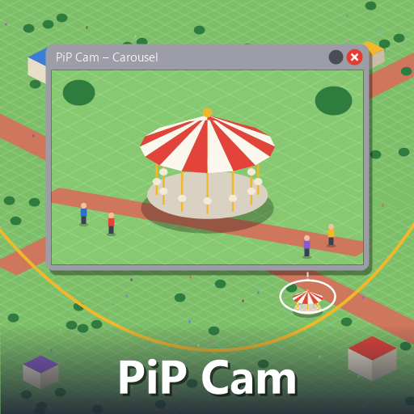

# PiP Cam

A [Parkitect](https://www.themeparkitect.com/) mod to keep an eye on more than one place at once: small live views of your park in windows, fixed on a spot or following a guest, a ride or a shop wherever it goes.



## How to use it

- Press **F4** to open a view. The key can be changed in the game's controls settings, under PiP Cam.
- With the window of a guest, an employee, a ride or a shop in front, the view follows them, and their name shows in the title. Otherwise it shows the spot in the middle of the screen.
- Views look at the park from the same angle as the game's camera, facing the way your camera faces.
- Open several views at once, and move or resize them like any other window.

### In a view

- **Click** to take the main camera to that spot.
- Drag with the **middle mouse button** to move the view. A view that was following someone stays where you leave it.
- Drag with the **right mouse button** to turn it.
- The **mouse wheel** zooms in and out.
- Click the **title** of a view that follows someone or something to open their window.

### Settings

Picture resolution, frames per second and the most views open at once (up to 6). Each open view draws the park again, so a lower resolution or fewer frames per second keep it light.

## Good to know

- Guests in a view move with their full animation, even when the main camera is far away. In a very wide view, past a couple of hundred guests, the rest are drawn the simpler way the game draws people far away.
- Views show the park without the game's color filter, bloom and cloud shadows.
- With the Perspective Camera mod, dragging with the middle mouse button in a view may also turn the main camera.
- The mod's texts are in English and Brazilian Portuguese, following the game's language.
- The views are only on your screen, so other players in a multiplayer game don't need the mod.

## Building

You need the .NET SDK and Parkitect installed.

```bash
dotnet build -c Release
```

The build copies the mod and the preview into `Documents/Parkitect/Mods/pip_cam`. If the game or the mods folder is somewhere else:

```bash
dotnet build -c Release -p:ParkitectManaged="<Parkitect>/Parkitect_Data/Managed" -p:ModOutputDir="<mods folder>/pip_cam"
```

## How it works

Each view has its own camera drawing into the window's picture. The game draws some things only for its main camera, so before each picture a view does for its camera what the game's park screenshot does for its own:

- the instanced scenery (`MeshChunker.render`) and the ride lights (`LightSequence.draw`);
- a terrain clip mask of its own, so tunnels cut the terrain open in the right places, with the shader values the game sets for the main camera (`TerrainClipsMaskTexture`, `clipToWorld`) swapped in only for the view's picture;
- people the main camera doesn't see.

The game animates people by their distance from its main camera, so people inside a view are told they are near and visible, and get their real state back from the game's own visibility tracking once no view shows them. The game's cloud shadow quad and anything on the main camera are hidden while a view draws.

| File | What it does |
| --- | --- |
| `src/pip_cam_mod.cs` | Entry point, key and settings UI |
| `src/pip_windows.cs` | Opens the view windows |
| `src/pip_view.cs` | One view: its camera, picture, controls and the steps around each picture |
| `src/people_boost.cs` | Full animation for people inside views |
| `src/selected_object.cs` | The object whose info window is in front |
| `src/title_click.cs` | Clicking a view's title |
| `src/pip_cam_settings.cs` | Settings, saved as JSON next to the game's settings |
| `src/texts.cs` | English and Brazilian Portuguese texts |

## License

[MIT](LICENSE)
